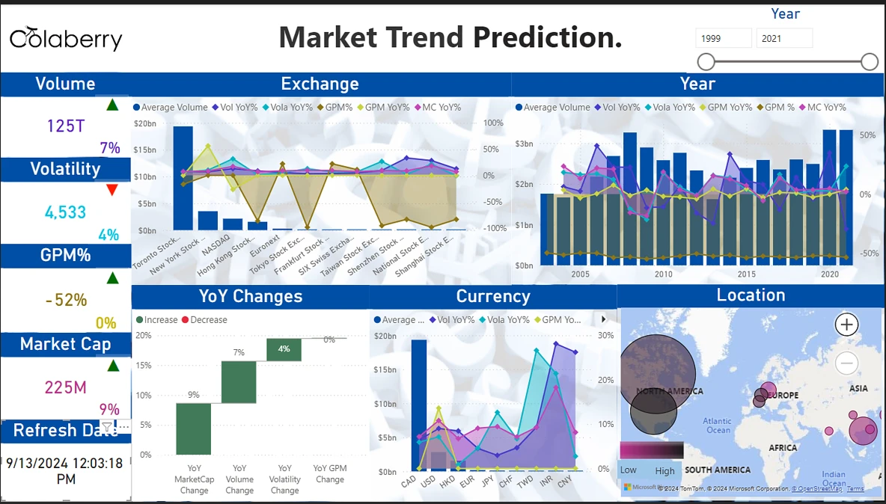

# 📈 Market Trend Prediction

Machine learning + Power BI project that analyzes global stock market KPIs (volume, volatility, gross profit margin, and market cap) to surface trends that help traders and investors make more informed, data-driven decisions.

🔗 **[View the live dashboard](https://app.powerbi.com/view?r=eyJrIjoiYWYzMzMzNDMtYjc5OS00MmFiLWE3MDYtOWQ1NTQ1YWViZjZmIiwidCI6ImYxYWQ2ODFmLTZmNjItNDNhOS04MjQxLTA3MDMxNjBlMTM0OCIsImMiOjN9)**

---

## Tools
- **Microsoft Fabric** (Data Wrangler) for data cleaning and transformation
- **Python** for ARIMA and LSTM time series forecasting
- **Power BI** for interactive dashboards

## Dataset
[Stock Exchange Data on Kaggle](https://www.kaggle.com/datasets/mattiuzc/stock-exchange-data?select=indexProcessed.csv) (`indexProcessed.csv`): historical index data from major exchanges worldwide, including NYSE, NASDAQ, Shenzhen, and the National Stock Exchange of India. Public data only; no personal or confidential information.

---

## Problem Statement
Stock market volatility makes it hard for individual investors to find good entry and exit points, and the AI-driven forecasting tools used by institutional investors are often out of reach. This project applies machine learning to publicly available market data to make trend insights more accessible.

## Objectives
- Analyze key KPIs to uncover hidden market trends
- Forecast trends at yearly, monthly, and weekly intervals
- Support decisions that reduce risk and optimize entry/exit timing

---

## Project Workflow
1. **Business problem:** defined the challenge of identifying entry/exit points in volatile markets
2. **Data gathering:** collected historical index data from Kaggle across multiple global exchanges
3. **Data preparation:** used Data Wrangler in Microsoft Fabric to remove nulls, handle zeros, address outliers, standardize KPIs, and add Year-over-Year features
4. **Model building:** trained ARIMA and LSTM time series models in Python
5. **Insights:** evaluated predictions to assess risk and reward across market conditions
6. **Visualization:** built an interactive Power BI dashboard for stakeholders

## Methodology
**Model selection.** Compared ARIMA and LSTM for their ability to handle both short- and long-term forecasting across yearly, monthly, and weekly intervals.

**Model development.** Trained on cleaned historical data and refined through parameter tuning and configuration testing to reduce prediction error.

---

## Results
- **Yearly prediction trend:** 0.56 (trend numeric 0.54), plotted across 2004–2024
- **Monthly and weekly trends:** forecasted direction and magnitude of change for each month and day of the week

### Model Performance
- Evaluated using **Mean Squared Error (MSE)** across forecast horizons
- MSE ranged from about 1.75 at horizon 0 and decreased at longer horizons in this evaluation
- Actual vs. predicted time series plots showed the model tracking overall market trends
- Short-term predictions showed higher error, a clear area for improvement

---

## Dashboard Features
- **KPIs:** Volume, Volatility, GPM %, Market Cap
- **Yearly trends** with a year range slicer
- **Exchange and currency comparisons** across global markets
- **YoY change waterfall** for volume, market cap, volatility, and GPM
- **Location map** of market performance by region

---

## Illustrative Investment Scenarios
*Simplified what-if examples using dashboard KPIs. These are for demonstration only, not financial advice or backtested returns.*

**Case 1: Shift from high volatility to stability (NASDAQ → NYSE)**
- NYSE: +56% YoY GPM, lower volatility
- NASDAQ: 32% YoY volatility, −27% GPM
- Scenario: reallocate a $100K portfolio 70/30 toward NYSE, for an illustrative outcome of ~31% ROI

**Case 2: Growth in emerging markets (Shenzhen & NSE)**
- Shenzhen: +33% YoY volume, +9% market cap
- NSE: +28% YoY volume, +18% market cap
- Scenario: illustrative outcome of ~48% ROI, with higher risk

**Takeaway:** Case 1 favors stability for risk-averse investors, and Case 2 favors growth with more risk.

---

## Lessons Learned
- **Balance matters:** combining stable and high-growth markets balances security and upside
- **Volatility management:** monitoring volatility and GPM trends helps flag instability early
- **Data-driven decisions:** KPIs like GPM, volume, and market cap growth sharpen investment analysis

## Future Work
- Improve short-term forecast accuracy
- Add proper backtesting of scenario strategies
- Expand to more emerging markets
- Explore automated strategies driven by real-time KPIs

---

## About
Built by **Mary Owenga**, Business Intelligence Analyst & Salesforce Administrator, as part of the Colaberry Power BI Center of Excellence program.

[Connect on LinkedIn](https://www.linkedin.com/in/mary-owenga-2b6010240/)
